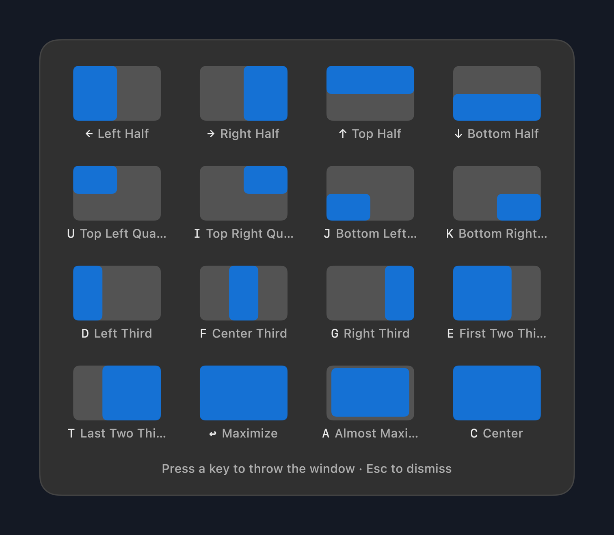
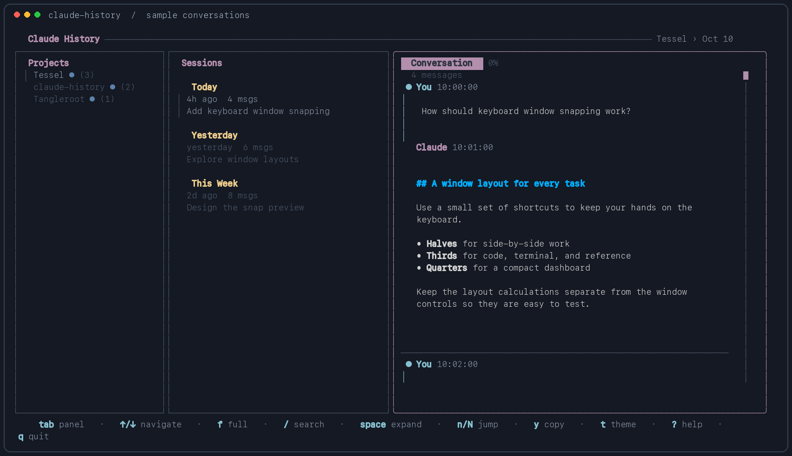
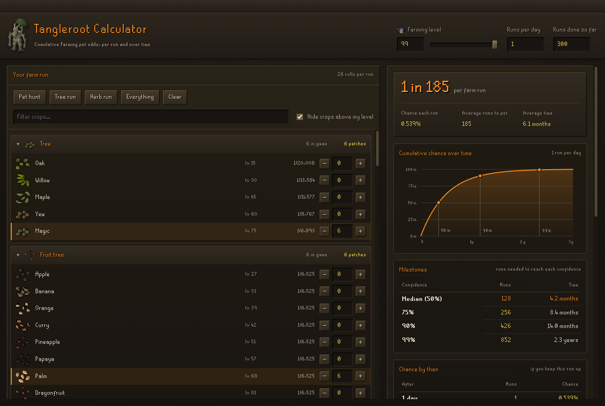

# Hey, I'm Chris.

I build tools that make my computer work the way I want—macOS utilities, terminal apps, and the occasional unnecessarily thorough RuneScape calculator.

**Swift · Go · TypeScript · JavaScript** &nbsp; / &nbsp; [chrispeterkins.com](https://chrispeterkins.com)

### A few things I've built

<table>
  <tr>
    <td width="42%" align="center">
      
    </td>
    <td>
      <h3><a href="https://github.com/ChrisPeterkins/Tessel">Tessel</a></h3>
      
Put your windows where you want them. Snap to halves, thirds, and quarters; move between displays; restore a whole workspace.

      
<strong>Native Swift · macOS · Zero dependencies</strong>

      <a href="https://github.com/ChrisPeterkins/Tessel#build--run">Build &amp; try it →</a>
    </td>
  </tr>
  <tr>
    <td width="42%" align="center">
      
    </td>
    <td>
      <h3><a href="https://github.com/ChrisPeterkins/claude-history">Claude History</a></h3>
      
Find that conversation you meant to save. Browse projects and sessions, search messages, and inspect tool calls without leaving the terminal.

      
<strong>Go · Bubble Tea · Local &amp; offline</strong>

      <a href="https://github.com/ChrisPeterkins/claude-history#install">Try it →</a> · <a href="https://github.com/ChrisPeterkins/codex-history">Also for Codex</a>
    </td>
  </tr>
  <tr>
    <td width="42%" align="center">
      
    </td>
    <td>
      <h3><a href="https://github.com/ChrisPeterkins/OSRS-Tangleroot-Drop-Calculator">Tangleroot Calculator</a></h3>
      
Because “one more farm run” deserves a probability curve. Plan your route and see your pet odds per run, over time, and through a dry streak.

      
<strong>JavaScript · Electron · Entirely offline</strong>

      <a href="https://github.com/ChrisPeterkins/OSRS-Tangleroot-Drop-Calculator#install">Try it →</a>
    </td>
  </tr>
</table>

**For the workday:** [Toolkit for DocuSign CLM](https://github.com/ChrisPeterkins/clm-helper-extension) — a Chrome extension with dark mode, UAT/PROD indicators, workflow shortcuts, and troubleshooting tools.

I like small tools with a clear purpose, keyboard shortcuts, and software that keeps working offline.
